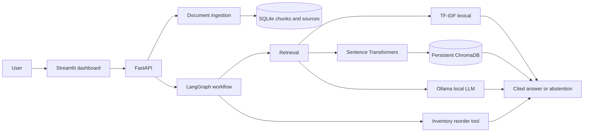

# Enterprise Knowledge Agent

A local-first Retrieval-Augmented Generation (RAG) and agent workflow demo built with synthetic policy documents. It combines lexical and vector retrieval, cited answers, LangGraph orchestration, and a read-only inventory reorder tool. Ollama provides optional local language-model generation; no paid OpenAI API is required.

The sample policies are fictional portfolio data. There is no live Shopify, Sage, customer, employee, or company-system integration.

## Architecture



Documents are chunked and stored with their source names in SQLite. Semantic indexing embeds those chunks locally and persists vectors in ChromaDB. LangGraph routes policy questions to retrieval and parsed inventory commands to a deterministic tool. When semantic retrieval or Ollama is unavailable, the agent falls back to lexical retrieval or an extractive answer and keeps source citations where evidence is available.

## Technology stack

- Python 3.14
- FastAPI and Uvicorn
- Streamlit
- Sentence Transformers with `sentence-transformers/all-MiniLM-L6-v2` CPU embeddings
- ChromaDB persistent vector storage
- LangGraph orchestration and LangChain Core message/tool schemas
- Ollama with `llama3.2:3b` for optional local generation
- SQLite for canonical document chunks
- scikit-learn TF-IDF lexical retrieval
- pytest regression tests

## Features

- Ingest custom documents and load the four synthetic benchmark policies without deleting custom-source documents.
- Retrieve policy evidence in lexical or semantic mode and return source/chunk citations.
- Build and inspect a persistent local semantic index.
- Use a LangGraph workflow for knowledge retrieval and structured inventory tool execution.
- Calculate proposed reorders without inventory writes; positive reorder recommendations require human approval.
- Fall back to cited extractive answers when Ollama is unavailable; abstain when no supporting evidence is found.
- Compare retrieval modes with Recall@k and per-query, mean, and p95 latency measurements.
- Enable a bounded, lexical-only public-demo mode using `PUBLIC_DEMO_MODE=1`.

## Windows installation

Run these commands from the project directory in PowerShell:

```powershell
py -3.14 -m venv .venv
$env:TEMP = Join-Path $PWD '.runtime\tmp'
$env:TMP = $env:TEMP
$env:HF_HOME = Join-Path $PWD '.models\huggingface'
New-Item -ItemType Directory -Force -Path $env:TEMP, $env:HF_HOME | Out-Null
.\.venv\Scripts\python.exe -m pip install --upgrade pip
.\.venv\Scripts\python.exe -m pip install -r requirements.txt
```

Install Ollama separately if it is not already installed, then obtain the local model:

```powershell
ollama pull llama3.2:3b
```

Ollama normally serves at `http://127.0.0.1:11434`. If it is not already running, start `ollama serve` in a separate terminal. Model files are managed by Ollama and must not be committed to this repository.

## Launch

In the FastAPI terminal, from the project directory:

```powershell
$env:OLLAMA_HOST = 'http://127.0.0.1:11434'
$env:OLLAMA_MODEL = 'llama3.2:3b'
$env:OLLAMA_TIMEOUT_SECONDS = '120'
.\.venv\Scripts\python.exe -m uvicorn app.api:app --host 127.0.0.1 --port 8000
```

In a second terminal:

```powershell
.\.venv\Scripts\python.exe -m streamlit run app/ui.py --server.address 127.0.0.1 --server.port 8501
```

- Dashboard: <http://localhost:8501>
- FastAPI documentation: <http://127.0.0.1:8000/docs>
- Health and index status: <http://127.0.0.1:8000/health>

Load **Sample policies** from the dashboard, then select **Build/update local semantic index**. The first run downloads the sentence-transformer model into `.models\huggingface`. No OpenAI key is used or required.

`OLLAMA_HOST`, `OLLAMA_MODEL`, and `OLLAMA_TIMEOUT_SECONDS` can be set before launching FastAPI. The 120-second default allows for local model cold starts. Successful generation and fallback status appear in the agent trace.

## Demo questions

Policy retrieval:

> When can a customer return an item?

Paraphrased semantic query:

> How long after delivery may an unused item be sent back in its original packaging?

Inventory tool:

> reorder SKU-12 available -4 threshold 10

The inventory example normalizes negative availability to zero and calculates a proposed quantity of 10. It does not change stock and marks the result as requiring approval.

## Evaluation methodology and verified results

The included synthetic benchmark has eight questions with expected policy-source labels. Recall@1 is the fraction whose expected source appears as the top retrieved result. The endpoint also reports each query's retrieval latency, mean latency, and p95 latency. These measurements cover the local retrieval operation; they are not production-scale or end-to-end service benchmarks.

One recorded Windows run on the bundled eight-question dataset produced:

| Retrieval mode | Correct at 1 | Recall@1 | Mean retrieval latency | p95 retrieval latency |
|---|---:|---:|---:|---:|
| Lexical TF-IDF | 6/8 | 0.75 | 4.432 ms | 5.834 ms |
| Sentence Transformers + ChromaDB | 8/8 | 1.00 | 10.609 ms | 14.196 ms |

These are observed results for this small synthetic corpus and machine, not a guarantee of accuracy or speed for other data or hardware. Re-run the dashboard evaluation to measure the current corpus and system.

## Tests

```powershell
.\.venv\Scripts\python.exe -m pytest -q
```

The automated tests use deterministic fake embeddings and mocked Ollama clients where needed. Passing tests do not by themselves prove that a local model is installed or that real Ollama inference succeeds; confirm the live agent trace reports `generate: ollama`.

## Public-demo mode

The lightweight dependency set omits ChromaDB and sentence-transformers. For a memory-limited free host, install `requirements-public.txt` and set `PUBLIC_DEMO_MODE=1` in both application processes:

```powershell
$env:PUBLIC_DEMO_MODE = '1'
.\.venv\Scripts\python.exe -m pip install -r requirements-public.txt
```

This mode bounds ingestion and uses lexical retrieval, citations, inventory analysis, LangGraph routing, and evaluation. It disables local semantic indexing and Ollama generation. Configure platform-specific service commands and ports with the hosting provider; free hosts may not preserve SQLite data across restarts.

## Limitations and security

- The policies and benchmark are small synthetic examples and do not establish production retrieval quality.
- Ollama generation is optional, local, and hardware-dependent. The extractive fallback is not generated prose.
- The inventory tool is a calculation only; there is no live inventory integration or write action.
- Authentication, authorization, rate limiting, production monitoring, and durable hosted storage are not implemented.
- Do not upload private business, customer, or employee records to a public demo.
- Keep credentials in process environment variables or a local ignored `.env` file. Never commit API keys, model weights, vector databases, logs, or private data.
